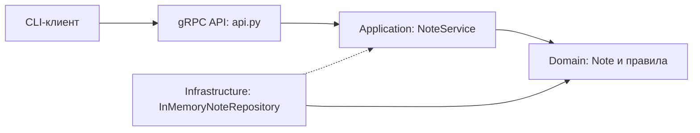

# Слои и зависимости

API переводит protobuf в доменные значения и ошибки в `context.abort`. Application содержит сценарии и зависит от протокола репозитория. Infrastructure реализует протокол и защищает память `RLock`. Domain не импортирует gRPC или protobuf. Зависимость к конкретному репозиторию создаётся в `build_server`; её можно заменить без изменения сценариев. Поток `ListNotes` получает снимок списка и на каждом шаге проверяет `context.is_active()`.
